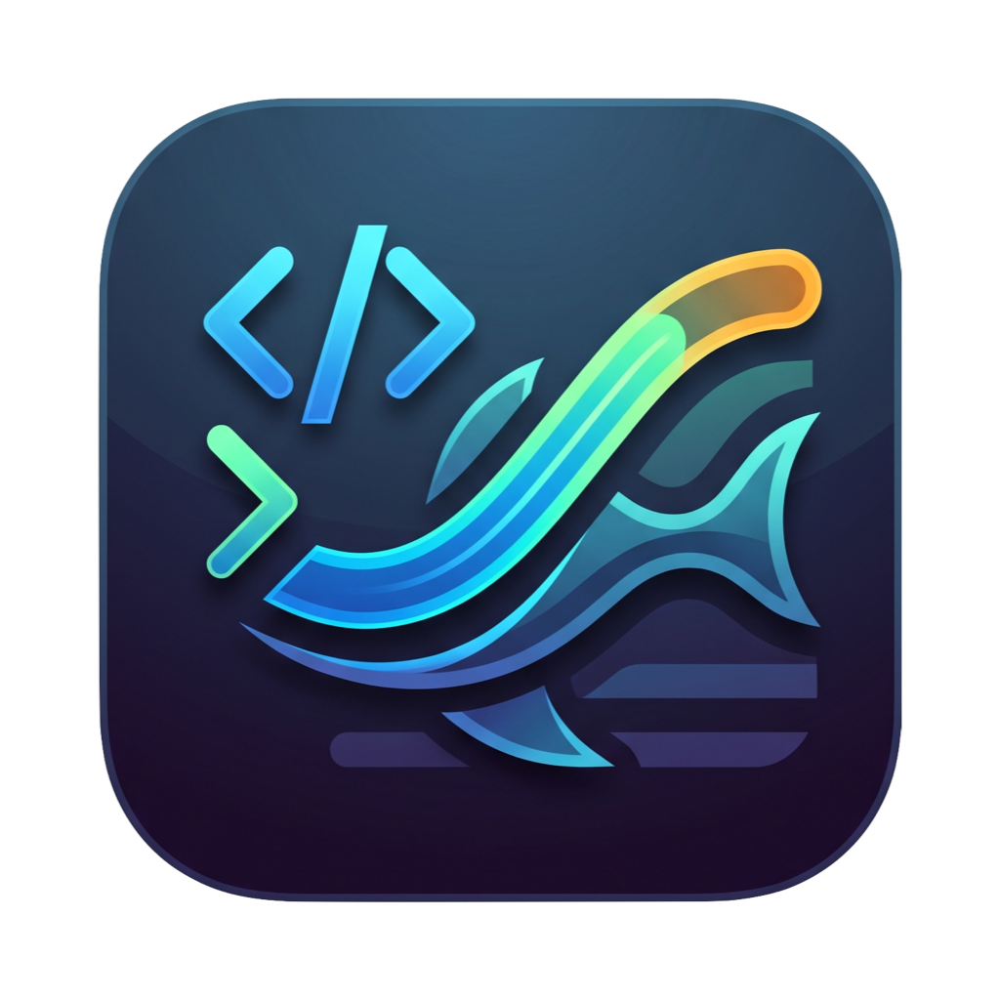

# Coding Agent Usage Bar

Mac のメニューバーに Claude Code と Codex の使用量 (セッション 5h / 週制限 /
クレジット消費) を円ゲージ + % で常駐表示するアプリです




## 表示内容

- **メニューバー**: 円ゲージ + パーセント。色は使用率で変化
  (70% 未満: 緑 / 70–90%: オレンジ / 90% 以上: 赤)。
  どちらのゲージかは設定でアイコン (Claude: `asterisk` / Codex: `hexagon`) か
  文字 (`Cl` / `Cx`) を選べる
- **クリックでポップオーバー**:
  - Claude: Session (5h) / Week (all models) / Week (モデル別) / Credits (monthly)。
    クレジット制のプランでは 5h / 週の代わりに Today (目安) / Week (目安)
  - Codex: Today (目安) / Week (目安) / Credits (クレジット消費・請求段階・次の段階までのバー)。
    レート制限があるプランでは 5h / 週も
  - 各リミットのリセット時刻と残り時間
- **設定 (歯車ボタン)**: Claude / Codex / 全体 のタブに分かれる。
  ウィンドウはタブの中身に合わせて伸び縮みし、画面に収まらない分はスクロールで見せる
  - Claude / Codex: 使用量を表示するかどうか (外すと配下の項目も非アクティブになり、API も叩かない)、
    メニューバーに出すかどうかと出す指標、日・週の目安 (出すかどうか、Today / Week それぞれの数え方、
    土日祝を除くかどうか)
  - Claude は月の上限の上書き (スイッチを入れた時だけ額の欄が出る)
  - Codex はクレジットの請求段階を出すかどうか
  - 全体: ログイン時に起動、メニューバーの識別子をアイコンにするか文字にするか、目安の 1 日の区切りの時刻
- 3 分ごとに自動更新 (API が 429 を返した場合は間隔を倍々で広げ、最大 30 分)

Codex を使っていない環境 (`~/.codex/auth.json` が無い) では Codex の行と設定が
無効になるので、見た目は従来どおり Claude だけになる。

## データ源

どちらもトークンを外部に送ることはない (それぞれの API に Authorization ヘッダ
として渡すのみ)。トークンの期限が切れると 401 になるが、Claude Code / Codex を
使えば自動で更新されるので、ポップオーバーにその旨を表示するだけにしている。

### Claude

Claude Code が macOS Keychain (`Claude Code-credentials`) に保存している
OAuth トークンを使い、`https://api.anthropic.com/api/oauth/usage` を叩く。
`/usage` コマンドと同じデータ。

クレジット制のプランでは `limits` が空で `five_hour` / `seven_day` も null になり、
月間のクレジット消費 (`spend`) だけが返る。この場合は Credits (monthly) に加えて、
月の上限を日割りした目安を Today (目安) / Week (目安) として出す (計算は [目安](#目安) を参照)。
月の上限は設定の Claude タブで上書きできる (スイッチを切るか額が空なら API の値)。Credits の % と目安はその額で計算する。

### Codex

Codex CLI が `~/.codex/auth.json` に保存している OAuth トークンを使い、
`https://chatgpt.com/backend-api/codex/usage` を叩く。`/status` と同じデータ。
ChatGPT backend は `User-Agent` が無いリクエストを 403 で弾くため、
リクエストには User-Agent を付けている。

#### 5h / 週制限の扱い

`rate_limit` (5h = primary / 週 = secondary) が返るのは Plus・Pro などの
レート制限プラン。ChatGPT Business / Enterprise シートでは null になり、
クレジット消費で管理されるため Credits だけが出る。

`additional_rate_limits` (モデル別・機能別の枠) は、使っていないモデルの枠が
0% で並ぶだけになるので **消費が 0 の枠は表示しない**。

#### クレジットの請求段階

`spend_control.individual_limit` から消費量・上限・残りを出し、請求段階と
**その段階の中でどこまで進んだか** をバーで添える。

| クレジット消費 | 請求 |
|---|---|
| 0 | なし |
| 上限の 1/20 まで | 40 ドル |
| 上限まで | 200 ドル |
| 上限超過 | 翌月まで利用不可 (上限緩和申請で継続可) |

素の段階は 1,000 / 20,000 クレジットだが、キャンペーンで上限が変わると境界も
同じ倍率で動くため、固定値ではなく API が返す `limit` に対する比率で判定して
いる (2026 年 7・8 月の 3 倍キャンペーン中は `limit` が 60,000 を返すので、
40 ドルの境界は 3,000 になる)。

上限に対する消費率は序盤ほとんど動かない (48.83 / 60,000 で 0.08%) ため、
段階内の進捗は別に出す。上の例なら 48.83 / 3,000 で 1.6% になり、
「次の段階まで 2,951」が見える。メニューバーの指標でもこの進捗を選べる。

`credits.balance` が返るクレジット残高制のプランでは、残高を別行で出す。

## 目安

クレジット制のプランは 5h / 週の枠が無く、請求期間 (月) の上限しか無い。
そこで上限を日割りした目安を Today (目安) / Week (目安) として出す。

- 請求期間: Claude は API がリセット日時を返さないので、Claude Code の `/usage` と同じく
  ローカル時刻の暦月とみなす。Codex は `spend_control.individual_limit.reset_at` の
  1 か月前から `reset_at` まで
- 目安は請求期間の長さに比例させて割り振る (1 日分 = 上限 ÷ 期間の日数)。
  週は月曜始まりで、請求期間をまたぐ週は期間の境界で区切る
- 「土日祝を除いて日割りする」を ON にすると、目安は平日だけに割り振る
  (1 日分 = 上限 ÷ 期間の平日の日数)。休日の Today は「目安なし」になる。
  祝日は振替休日・国民の休日を含めてアプリ内で計算する (年末年始などの会社の休みは含まない)
- 「1 日の区切り」(全体タブ。Claude と Codex で共通) を 0 時以外 (例: 5:00) にすると、
  Today / Week はその時刻で切り替わり、深夜 0〜5 時の使用は前日の分になる。
  請求期間 (月) の境界は API に合わせたまま
- 数え方と土日祝を除くかどうかは、Claude / Codex ごとに設定で選べる (数え方は Today / Week それぞれ)

| 数え方 | 使用 | 目安 |
|---|---|---|
| 今日までの累計 (既定) | 請求期間の初めからの累計 | 期間の初めから今日 (今週) の終わりまでの目安の累計 |
| 今日 / 今週使った分 | 今日 (今週) に使った分 | 1 日 (1 週) 分の目安 |
| 残りを日割り | 今日 (今週) に使った分 | 今日 (今週) の初めに残っていた額 ÷ 月末までの日数 × 今日 (今週) の日数 |

上限 $800・10/13 (火)・今月の累計 $200 なら、累計で数えた時は
Today が $200 / $335.48 (10/1〜10/13) で 60%、Week が $200 / $464.52 (10/1〜10/18) で 43%。
使いすぎた分はそのまま持ち越すので、朝の時点で 100% を超えることもある。

「残りを日割り」は、前日までの使いすぎや使い残しを月末までの日数で均した目安になる。
同じ上限 $800 で 10/16 (金) の朝に累計 $180 なら、残り $620 ÷ 16 日 = $38.75 が今日の目安
(土日祝を除くと、残りの平日 11 日で割って $56.36)。

API は請求期間の累計しか返さないので、「使った分」はアプリが取れた累計を日ごとに最初と最後の
1 件ずつ UserDefaults に残しておき、前日 (週なら前週の最終日) の最後の記録との差で数える。
Mac がスリープしていた間の使用もその日の分に入るので、日ごとの分を足すと累計に一致する。

直前 24 時間以内に記録が無い時 (アプリを入れた日や、Mac を 1 日以上止めていた後) は、
その日 (週) 最初に取れた時からの分になり、「記録は 12:58 から」のように添える。
それより前の使用は数えられない。

## インストール

### Homebrew (ビルド不要)

```sh
brew install --cask saba383810/tap/coding-agent-usage-bar
```

未署名なので、Gatekeeper に止められないよう Cask がインストール後に quarantine 属性を外す。

Cask は `version :latest` なので、通常の `brew upgrade` では更新されない。
新しいリリースを入れる時は `brew upgrade --cask --greedy coding-agent-usage-bar`。

### Releases から直接 (ビルド不要)

[Releases](../../releases/latest) の `CodingAgentUsageBar.zip` を展開して
`/Applications` に入れる。未署名のため、そのまま開くと Gatekeeper に止められるので
初回だけ次のどちらかを行う。

- `xattr -dr com.apple.quarantine /Applications/CodingAgentUsageBar.app`
- 一度開こうとした後、システム設定 → プライバシーとセキュリティ の「このまま開く」

### ソースからビルド

Xcode 不要。Command Line Tools の Swift でビルドできる。

```sh
./install.sh
```

ビルドして `/Applications` に配置し、起動中なら差し替えてから立ち上げるところまで
やる。更新したい時も同じコマンドを再実行するだけでよい。

`.app` を作るだけなら `./build.sh` (成果物は `build/CodingAgentUsageBar.app`)。

### アンインストール

```sh
./uninstall.sh           # 設定は残す
./uninstall.sh --purge   # 設定も消す
```

Homebrew で入れた場合は `brew uninstall --cask coding-agent-usage-bar`
(`--zap` を付けると設定も消える)。

## ログイン時に自動起動

メニューバーのアイコン → 歯車 → 「ログイン時に起動」を ON にする。
`SMAppService` でアプリ自身を登録するので、システム設定を開く必要はない。
macOS が承認を求めた場合だけ、システム設定 → 一般 → ログイン項目 で許可する。

## 構成

```
Package.swift                     SwiftPM 定義
Sources/CodingAgentUsageBar/
  App.swift                       MenuBarExtra 本体・メニューバーラベル
  ContentView.swift               ポップオーバー UI
  SettingsView.swift              設定 UI と設定ウィンドウ
  UsageSettings.swift             設定の永続化 (UserDefaults)
  UsageModel.swift                状態管理・ポーリング・メニューバー指標の選択
  UsageLimit.swift                共通モデル (UsageLimit / UsageError / パース補助)
  SpendPace.swift                 日・週の目安と、日ごとの累計の記録
  PaceCalendar.swift              目安の 1 日の区切り・土日祝の除外・日本の祝日
  ClaudeUsageAPI.swift            Keychain 読み取り + Anthropic の usage API
  ClaudeBudget.swift              Claude の月間消費から目安と Credits の行を組み立てる
  CodexUsageAPI.swift             ~/.codex/auth.json 読み取り + ChatGPT の usage API
  LoginItem.swift                 SMAppService でのログイン項目登録
  GaugeIcon.swift                 円ゲージ描画 (NSImage) と色
Info.plist                        LSUIElement=true (Dock 非表示)
Resources/AppIcon.png             アプリアイコン (build.sh が .icns に変換する)
build.sh                          ビルド + .app バンドル組み立て
install.sh / uninstall.sh         /Applications への導入・削除
Casks/                            Homebrew Cask の定義
.github/workflows/release.yml     タグを打つと zip を Releases に添付する
```

## リリース

```sh
git tag v1.1.0 && git push origin v1.1.0
```

Actions がビルドして `CodingAgentUsageBar.zip` を Releases に添付する。
Cask は `version :latest` なので、リリースごとに書き換える必要はない。

Homebrew で配る場合は `saba383810/homebrew-tap` に `Casks/coding-agent-usage-bar.rb`
を置く (このリポジトリの `Casks/` がそのまま使える)。Cask を変えたら tap 側にも反映する。

## License

[MIT License](LICENSE)
